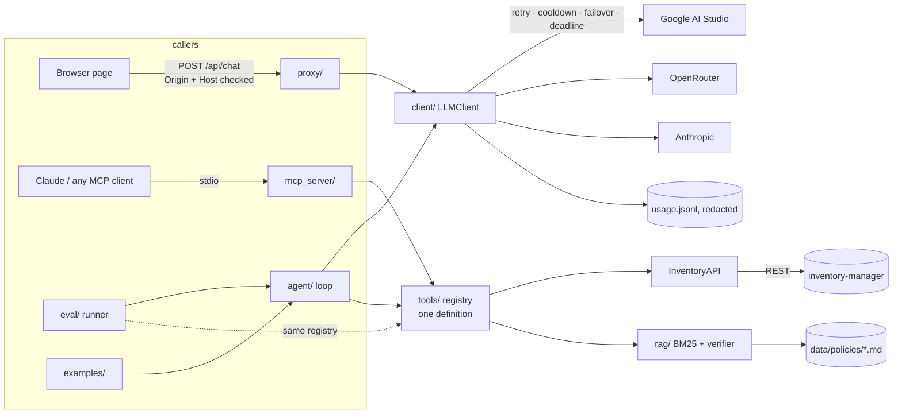

# llm-toolkit


Small, dependency-light Python building blocks for LLM tools that keep working when providers
misbehave:

| Module | What it does |
|---|---|
| `client/` | One chat API over OpenRouter, Google AI Studio (OpenAI-compatible) and the Anthropic Messages API, with retry (exponential backoff + jitter, `Retry-After`), provider cooldown, failover, separate connect/read timeouts, a **total deadline per request**, a hard request budget and a thread-safe JSONL usage log |
| `agent/` | A bounded tool-calling loop with strict argument validation and token-budgeted history trimming that never splits a tool call from its results |
| `rag/` | Chunking, pure-Python BM25 (with a pluggable `Retriever` interface for embeddings), cited answers, and a **verifier** that drops every quote not found verbatim in a retrieved chunk |
| `eval/` | Cases as JSON, code graders, append-only JSONL results, `infra_error` kept apart from model failures, per-model accuracy / p50 / p95 / tokens / cost, and a planted-defect benchmark for the verifier |
| `tools/` | The **single** tool definition shared by the agent, the eval harness and the MCP server |
| `mcp_server/` | An MCP server (official Python SDK) exposing an inventory REST API and `rag.search` as tools |
| `proxy/` | A key-holding HTTP proxy with real status codes, Origin and Host allowlists, a total deadline, an atomic daily cap and safe static files |
| `skills/` | A Claude Skill (`SKILL.md`) that teaches a model how to use these MCP tools to manage stock |

Runtime dependencies: `httpx`, `pydantic`, `mcp`. No agent framework.

All sample data (the "Pinewick Supply" policies and inventory) is fictional.

## Architecture



## Quick start

```bash
python -m venv .venv
.venv/Scripts/activate            # Windows; on Linux/macOS: source .venv/bin/activate
pip install -e ".[dev]"
```

```bash
python -m pytest
```

```bash
ruff check . && ruff format --check .
```

Everything below runs **without an API key and without a network** in `--offline` / `--fake-backend` mode:

```bash
python examples/policy_agent.py --offline "Can I return opened electronics?"
```

```bash
python examples/stock_agent.py --offline
```

```bash
python examples/mcp_stdio_demo.py
```

With a key in the environment (`GEMINI_API_KEY`, `OPENROUTER_API_KEY` and/or `ANTHROPIC_API_KEY`), drop
`--offline` to use a real model. Keys are only ever read from the environment.

### MCP server

```bash
INVENTORY_API_URL=http://127.0.0.1:8000 python -m llm_toolkit.mcp_server
```

`--fake-backend` serves an in-memory fictional inventory instead. Tools: `list_items`, `get_item`,
`issue_stock`, `undo_last_change`, `search_policies`. Example client config (`.mcp.json`):

```json
{
  "mcpServers": {
    "llm-toolkit": {
      "command": "python",
      "args": ["-m", "llm_toolkit.mcp_server"],
      "env": { "INVENTORY_API_URL": "http://127.0.0.1:8000" }
    }
  }
}
```

The backend is inventory-manager (a separate repository of mine: a standard-library REST
API). Backend rejections reach the model as `is_error` tool results with the backend's own text, for
example `only 3 in stock, cannot issue 10`. `undo_last_change` needs an inventory-manager whose `POST /api/undo` accepts
`{"expected": label}`; an older backend ignores the field and would undo unconditionally.

### Proxy

```bash
python -m llm_toolkit.proxy --port 8787 --daily-cap 200
```

Open `http://127.0.0.1:8787/`. Requests must carry an allowed `Origin` and `Host`; errors use real
status codes (400/403/405/411/413/415/421/429/502/503/504), never 200.

### Eval

```bash
python -m llm_toolkit.eval check                 # validate case files
python -m llm_toolkit.eval verifier-bench        # offline benchmark of the quote verifier
python -m llm_toolkit.eval run --max-requests 30 # live; skipped when no key is set; hard cap 30
python -m llm_toolkit.eval report                # rebuild results/eval/REPORT.md from the JSONL
```

## Configuration

| Variable | Meaning |
|---|---|
| `GEMINI_API_KEY`, `OPENROUTER_API_KEY`, `ANTHROPIC_API_KEY` | Provider keys. A provider without a key is skipped |
| `LLM_TOOLKIT_PROVIDERS` | Failover order, default `google,openrouter,anthropic` |
| `LLM_TOOLKIT_GOOGLE_MODEL`, `..._OPENROUTER_MODEL`, `..._ANTHROPIC_MODEL` | Model ids (defaults in `client/providers.py`) |
| `INVENTORY_API_URL` | inventory-manager base URL, default `http://127.0.0.1:8000` |

## Results

All numbers come from runs in this repository. Raw records are in `results/eval/*.jsonl` (append-only)
and the summary in [`results/eval/REPORT.md`](results/eval/REPORT.md) is generated from them.

**Citation verifier, offline** (`verifier-bench`, dataset `data/eval/planted_citations.json`, generated
by code from the fictional corpus): 10 answers, 124 citations, 11 planted defect types (paraphrase,
changed number, flipped negation, changed case, doubled space, fabricated sentence, wrong chunk, chunk
not retrieved, unknown chunk, empty, too short).

- planted defects dropped: **104/104**
- genuine quotes kept: **20/20**

The verifier is exact string matching, so this is a regression check of its rules, not a measure of
semantic grounding. What it buys is visible in the live runs: a quote a model rewords is dropped and
counted instead of being shown as evidence.

**Live runs** (free-tier `google:gemini-3.6-flash`, temperature 0, at most 30 HTTP requests per run):

| run | suite | graded | pass | infra errors | other | p50 / p95 latency | mean tokens in / out |
|---|---|---|---|---|---|---|---|
| `20261116T233749Z-e646b9` | rag | 5 | 4 | 3 (read timeouts) | – | 16,156 / 17,313 ms | 425 / 76 |
| `20261116T233749Z-e646b9` | agent | 1 | 1 | 7 (daily quota 429, then cooldown) | – | 28,953 ms (1 case) | 1,246 / 36 |
| `20261116T195444Z-1ea9e1` | both | 0 | 0 | 13 (503, 429, OpenRouter 402) | 3 errors (HTTP 400) | – | – |

In the RAG run all 4 verified quotes were verbatim (0 dropped). Read these numbers for what they are:

- **The sample is small.** The free tier's daily quota ended the second run after 15 requests, so
  most agent cases are recorded as `infra_error` and excluded from accuracy. Cost is `n/a`: the free
  tier reports none.
- **The first run found a bug.** Gemini answered the second round of every tool call with HTTP 400
  ("function call is missing a thought_signature"): the adapter dropped provider fields from tool
  calls. Because 400 is classified as a request error (raised, not failed over), it surfaced
  immediately. The adapter now replays provider fields to the provider that sent them
  (`test_provider_tool_call_fields_are_replayed_to_the_same_provider_only`); the second run's
  multi-round agent case passed.
- **The one RAG "fail" is a grader false negative.** The model correctly said "the provided excerpts
  do not state whether orders can be shipped to Japan"; the first `abstains` pattern did not match
  "do not state". The grader was fixed (`test_abstains_grader` uses that exact sentence), but the
  recorded line stays `fail` because results are never rewritten.

## Lessons from earlier prototypes

This repo rewrites ideas from two of my earlier personal projects: **prototype A**, a single-page
tool-calling assistant with a Node.js key-holding proxy and a benchmark script, and **prototype B**, a
TypeScript chat feature with provider fallback. Both worked for one user, and both had weak points
that a reusable toolkit cannot have. No file was copied; each weak point below has a test that would
fail if it came back. Figures about the prototypes were measured in a private prototype.

### LLM client

| Weak point in the prototype | Fix here | Test |
|---|---|---|
| B: no retry at all; A: linear waits (1.5 s × n) | Exponential backoff, full jitter, capped | `test_backoff_is_exponential_with_full_jitter` |
| Neither honoured `Retry-After` | Wait at least `Retry-After` (seconds or HTTP date) | `test_retry_after_seconds_and_http_date_are_honoured` |
| B: every 4xx failed over silently, hiding bad keys and paying for doomed requests | 400/422 raise at once; 401/402/403/404 fail over with an ERROR log and a recorded attempt | `test_bad_request_400_and_422_raise_without_failover`, `test_auth_and_model_errors_fail_over_with_error_log`, `test_provider_errors_on_every_provider_raise_all_failed` |
| B: no cooldown, every request hit the dead provider first | Quota 429 puts the provider in cooldown | `test_quota_429_cools_down_provider_for_next_request` |
| A: quota detection relied on one provider's error text; cooldown lost on restart | `Retry-After` first, per-provider patterns second; optional file-backed store | `test_cooldown_from_retry_after_without_body_text`, `test_cooldown_survives_restart_with_file_store` |
| A: ~225 s worst case (measured in a private prototype); B: providers × 60 s | One deadline across retries, waits and failover; read timeout shrinks to the time left | `test_total_deadline_caps_retries_and_failover`, `test_read_timeout_never_exceeds_remaining_deadline` |
| A: a gateway error returned as "content" raised instead of failing over | Counted as a failed attempt; next provider answers | `test_disguised_gateway_error_fails_over`, `test_non_json_200_body_fails_over` |
| A: that check existed twice with different patterns | One definition | `test_gateway_error_patterns_have_one_definition` |
| B: list-of-parts content became `"[object Object]"` | Text parts joined | `test_content_parts_are_joined_as_text` |
| B: no usage accounting | Thread-safe JSONL usage log; prompt-token alarm | `test_usage_log_is_valid_jsonl_under_concurrent_writes`, `test_prompt_token_alarm_logs_warning` |
| Raw upstream text went to logs | Keys, `Authorization`, JWTs redacted on every log path | `test_logs_redact_keys_bearer_and_jwt`, `test_usage_log_never_contains_key_values`, `test_request_error_message_does_not_echo_the_key` |
| Port hazard: `retries or 2` turns 0 into 2 | `max_retries=0` means one attempt | `test_zero_retries_means_single_attempt` |

### Agent loop

| Weak point | Fix | Test |
|---|---|---|
| A: malformed tool-call JSON was silently replaced with `{}` | The decoder's message goes back to the model | `test_malformed_tool_json_is_reported_to_model` |
| A: unsupported arguments were silently ignored; loose number coercion | Strict pydantic models, unknown fields rejected, per-field errors returned | `test_unknown_argument_is_rejected`, `test_schema_mismatch_lists_field_errors`, `test_strict_types_do_not_coerce_strings` |
| Defaults must never be invented | Required fields have no defaults; handlers see only what was sent | `test_missing_required_field_is_not_defaulted`, `test_optional_field_not_sent_is_not_passed_to_handler` |
| A tool exception must not end the turn | Returned as an error; `KeyboardInterrupt` still propagates | `test_tool_exception_is_returned_as_error`, `test_keyboard_interrupt_is_not_swallowed` |
| A: at the round limit, history ended with tool results and no reply | A closing assistant message keeps history valid | `test_round_limit_leaves_history_valid` |
| A: history window counted messages, not tokens | Token budget; tool calls and their results trimmed as one unit (Hypothesis, `@seed(20261117)`, 500 examples each) | `test_trim_history_never_orphans_tool_messages`, `test_trim_history_respects_token_budget`, `test_trim_history_keeps_latest_user_message`, `test_trim_history_repairs_corrupted_heads` |

### Evaluation

| Weak point | Fix | Test |
|---|---|---|
| A: the bench kept its own copy of the tools; the copies drifted while a schema check said "no drift" | One registry for agent, eval and MCP | `test_agent_eval_and_mcp_share_one_tool_definition` |
| A: results were overwritten, so headline numbers had no raw file | Append-only JSONL; README numbers come from the generated report | `test_results_are_appended_not_overwritten`, `test_report_is_generated_from_results_file` |
| A: 429/503 were scored as model failures | `infra_error` is excluded from accuracy | `test_infra_errors_are_excluded_from_accuracy`, `test_request_errors_are_reported_as_errors_not_infra` |
| A: one run per case, no temperature recorded; bench used a different round limit than the app | Repeats, temperature, git SHA, prompt and schema hashes on every line; the real `Agent` runs the cases | `test_result_lines_record_run_settings`, `test_runner_uses_agent_max_rounds` |
| A: "critical" was an emoji in a description | A `critical` field in a strict schema | `test_case_schema_rejects_unknown_fields` |
| Live runs must stay within 30 requests | Hard cap counted in HTTP requests, retries included | `test_run_stops_at_request_budget` |

### RAG

| Weak point | Fix | Test |
|---|---|---|
| B: grounding was prompt-only, with no output check | Quotes must be verbatim substrings of a retrieved chunk; others are dropped and counted | `test_fabricated_quote_is_dropped_and_counted`, `test_quote_from_unretrieved_chunk_is_dropped`, `test_near_miss_quotes_are_dropped`, `test_verifier_bench_detects_every_planted_defect_type` |

### Proxy

| Weak point in prototype A's proxy | Fix | Test |
|---|---|---|
| Errors returned as HTTP 200 | Real status codes | `test_upstream_failures_map_to_real_status_codes`, `test_bad_requests_get_4xx`, `test_upstream_bad_request_is_not_hidden_as_200` |
| No `Origin` header meant "allowed" | `Origin` required and allowlisted | `test_missing_origin_is_rejected`, `test_unlisted_origin_is_rejected` |
| `Host` not checked (DNS-rebinding shape accepted) | `Host` allowlist, 421 | `test_dns_rebinding_host_is_rejected` |
| No overall deadline | Deadline passed to the client; 504 | `test_deadline_exceeded_returns_504`, `test_proxy_passes_its_deadline_to_the_client` |
| Body cap counted characters and dropped the connection without a reply | Byte cap from `Content-Length` before reading; 413 | `test_oversized_body_returns_413` |
| Any caller could send its own system prompt and tool list | The server owns both; only user/assistant text accepted | `test_client_cannot_send_system_or_tools` |
| Static server exposed files outside the app | Root + extension allowlist + resolved-path check + dotfile block + bad-`%` → 400 | `test_static_blocks_traversal` (15 cases) |
| B: daily cap was count-then-insert (racy) | Atomic counter; attempts counted before the call | `test_daily_cap_is_atomic_under_concurrency` |

### MCP server

| Requirement | Test |
|---|---|
| A backend rejection reaches the model as an error with the backend's text | `test_insufficient_stock_error_reaches_client`, `test_insufficient_stock_error_reaches_the_agents_model` |
| A stock write is never retried blindly | `test_issue_stock_is_not_retried_on_timeout` |
| Undo cannot reverse someone else's change: the backend checks `expected` under the same lock as the undo (no check-then-act race) | `test_undo_refuses_unexpected_label`, `test_tools_against_real_inventory_manager` |
| The fake backend behaves like the real one | `test_tools_against_real_inventory_manager` (runs when `INVENTORY_MANAGER_PATH` is set) |

## Limitations

- The total deadline bounds every wait and every phase timeout, but a server that trickles bytes slower
  than the read timeout can stretch a single attempt; streaming responses are not supported.
- History trimming uses an approximate token count (characters / 4); plug in a tokenizer through
  `count_tokens` if you need precision. The current turn is always sent, even if it alone exceeds the budget.
- The cooldown store is per process unless a file path is given; it is not shared across machines.
- If a conversation fails over mid-turn from one provider to Gemini, Gemini may reject earlier tool calls
  that carry no thought signature (surfaces as a 400 request error).
- BM25 uses a simple English tokenizer with a tiny suffix stripper.
- The proxy only forwards chat messages: it does not run tools.

Design notes: [`docs/design.md`](docs/design.md).

Built with Claude Code as a pair programmer; the design decisions and testing strategy are my own.

## License

MIT
